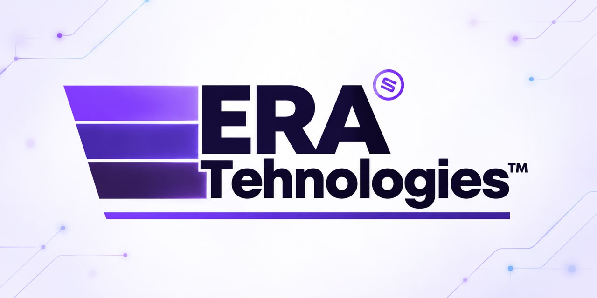

# ERA Technologies™

  

**Thoughtful engineering. Responsible development.**  
**Technology built with purpose.**

ERA Technologies is a technology company focused on designing, engineering, and developing digital products, software platforms, and technology solutions. We approach product and platform work with a practical, disciplined mindset: building maintainable systems, prioritizing engineering quality, and creating technology that is dependable, scalable, and responsible in use.

## Company overview

ERA Technologies focuses on digital product engineering, software platform development, and technology solutions designed for long-term maintainability and practical value. Our work emphasizes engineering quality, well-structured architecture, and responsible development practices that support resilient software and meaningful digital experiences.

We value clear technical decisions, maintainable systems, and the careful delivery of digital products that are built to evolve with real-world needs.

## What we do

### Digital Platforms
Build product foundations and platform experiences that support scale, flexibility, and long-term maintainability.

### Product Engineering
Design and engineer digital products with clear product logic, resilient implementation, and dependable delivery.

### Software Architecture
Create systems and design patterns that support sustainability, scalability, and thoughtful technical evolution.

### Technology Solutions
Develop practical technology solutions that align with business needs, engineering constraints, and real user value.

### System Integration
Connect platforms, services, and workflows in ways that improve continuity and operational clarity.

### Responsible Technology
Approach technology decisions with accountability, privacy awareness, and practical judgment.

## Products

### NexBook

**A flexible booking and business-management platform in development.**

**Status:** `In Development`

NexBook is being shaped as a configurable platform intended to support scheduling, coordination, and business workflows as the product matures. It is not presented as a commercially launched, production-ready, or customer-available offering, and its scope may evolve as development progresses.

## Engineering principles

- **Quality** — Thoughtful execution, durable work, and measurable engineering maturity.
- **Security** — Security is designed in from the start, not treated as an afterthought.
- **Privacy** — Respecting user expectations and handling information responsibly.
- **Reliability** — Systems that behave predictably and remain stable under real-world conditions.
- **Scalability** — Architecture that can evolve with changing complexity and demand.
- **Accessibility** — Inclusive design and usable experiences across a wide range of needs.
- **Documentation** — Clear, maintainable guidance that helps teams collaborate and understand the work.
- **Maintainability** — Code and systems that are understandable, verifiable, and straightforward to evolve.
- **Responsibility** — Building technology with care, accountability, and practical judgment.
- **Transparency** — Honest communication about status, decisions, and progress.

## Explore ERA Technologies

- [Official website](https://www.eratechnologies.co)
- [GitHub organization](https://github.com/ERATechnologies)
- [Organization profile](https://github.com/ERATechnologies)

This organization profile is the public entry point while additional repositories and public materials are developed and shared.

## Official links

- [Official website](https://www.eratechnologies.co)
- [GitHub organization](https://github.com/ERATechnologies)

## Footer

  

ERA Technologies™. Product names, availability, and capabilities are subject to change as development progresses.

© ERA Technologies™. Product names, availability, and capabilities are subject to change as development progresses.
