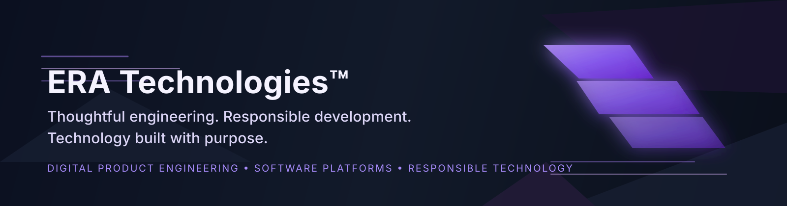

# ERA Technologies™

**Thoughtful engineering. Responsible development. Technology built with purpose.**

ERA Technologies is a technology company focused on designing, engineering, and developing digital products, software platforms, and technology solutions. We approach delivery with a practical mindset: building maintainable systems, prioritizing engineering quality, and creating technology that is dependable, scalable, and responsible in use.

## Company overview

ERA Technologies focuses on digital product engineering, platform development, and technology solutions designed for long-term maintainability and practical value. Our work emphasizes engineering quality, thoughtfully designed architecture, and responsible development practices that support resilient software and meaningful digital experiences.

This foundation supports scalable systems, sensible product thinking, and the delivery of technology with clarity and purpose.

## What we do

1. Digital Platforms
2. Product Engineering
3. Software Architecture
4. Technology Solutions
5. System Integration
6. Responsible Technology

These focus areas reflect how ERA Technologies approaches modern engineering work: building robust platforms, enabling practical product delivery, and shaping technology solutions that are dependable, adaptable, and easy to evolve.

## Products

### NexBook

**A flexible booking and business-management platform in development.**

**Status:** `In Development`

NexBook is being shaped as a flexible platform intended to support scheduling, coordination, and business workflows as the product matures. It is not presented as a commercially launched, production-ready, or customer-available offering. Additional capabilities and product direction will be shared as development progresses.

## Engineering principles

- **Quality** — Thoughtful engineering, clear implementation choices, and durable outcomes.
- **Security** — Products and systems should be designed with security in mind from the outset.
- **Privacy** — Respecting user expectations and responsible handling of information.
- **Reliability** — Stable systems that behave predictably under real-world conditions.
- **Scalability** — Architecture that can evolve with user needs, complexity, and growth.
- **Accessibility** — Inclusive design and usable experiences for a wide range of people.
- **Documentation** — Clear, maintainable guidance that supports long-term understanding and collaboration.
- **Maintainability** — Code and systems that are understandable, verifiable, and straightforward to evolve.
- **Responsibility** — Building technology with care, accountability, and practical judgment.
- **Transparency** — Honest communication about status, decisions, and development progress.

## Explore our work

Our public GitHub presence is being expanded as work is published. The organization profile is the public point of reference for ERA Technologies while repositories evolve and are shared with the community.

- [GitHub organization](https://github.com/ERATechnologies)

## Working with us

ERA Technologies values clear communication, thoughtful technical decisions, and reliable delivery. We work with a focus on quality, maintainability, and responsible engineering practices, aiming to create systems and products that are structured for long-term use and honest progress.

When a repository includes contribution guidance, those instructions should be followed in context. Our public work is guided by practical engineering standards and a transparent approach to collaboration.

## Official links

- [Official website](https://www.eratechnologies.co)
- [GitHub organization](https://github.com/ERATechnologies)

© ERA Technologies™. Product names, availability, and capabilities are subject to change as development progresses.
